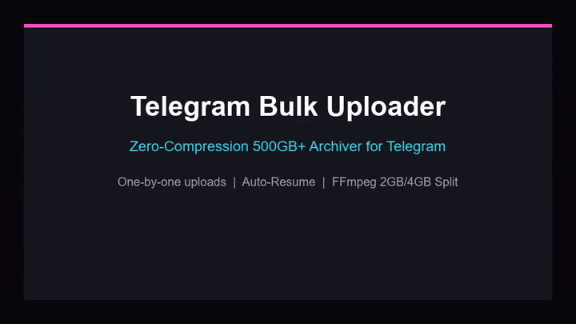
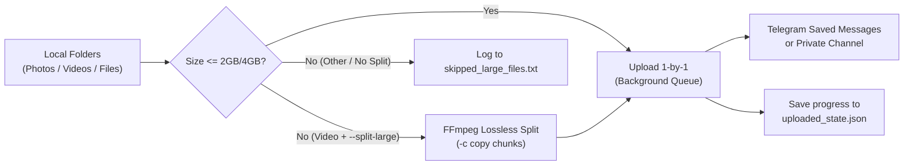

# Telegram Bulk Uploader

[](https://www.python.org/downloads/)
[](LICENSE)
[](https://github.com/LonamiWebs/Telethon)
[](https://fastapi.tiangolo.com/)

A **user-friendly Web Dashboard + CLI tool** built on [Telethon](https://github.com/LonamiWebs/Telethon) and [FastAPI](https://fastapi.tiangolo.com/) to recursively archive large local photo, video, and document libraries (100GB–500GB+) to Telegram **one by one** without compression.

<p align="center">
  
</p>

> 🎬 Prefer MP4? Download or watch [assets/demo.mp4](assets/demo.mp4).

---

## The Problem vs. The Fix

| The Pain | How This App Solves It |
| :--- | :--- |
| 💥 **Hitting the 2GB Limit** | Uploads every photo, video, and file **one by one**—so a 500GB folder never fails as a single giant archive. |
| ✂️ **4K Videos Over 2GB/4GB** | **FFmpeg Auto-Split** slices oversized videos losslessly (`-c copy`) into Telegram-safe parts and cleans up after. |
| 📉 **Quality Loss & Compression** | Sends files as **uncompressed documents** by default—zero bitrate drop, full RAW/EXIF metadata preserved. |
| 📶 **Wi-Fi Drops & Rate Limits** | **Auto-Resume** (`uploaded_state.json`) skips finished files and waits out `FloodWaitError` cooldowns automatically. |
| 🖥️ **No Ugly Terminal Setup** | Launch a **sleek Web Dashboard** with 1 click (`start.bat` / `start.sh`), sign in via OTP/2FA, pick folders, and upload in the background. |

---

## How It Works



---

## 1-Click Quick Start (Web UI)

Anyone who clones this repository can launch the Web UI in seconds—no manual `.env` editing required.

### 1. Clone the repository
```bash
git clone https://github.com/adityaagrawal04/telegram-bulk-uploader.git
cd telegram-bulk-uploader
```

### 2. Launch with one command
- **Windows:** Double-click `start.bat` (or run `.\start.bat` in PowerShell)
- **macOS / Linux:**
  ```bash
  chmod +x start.sh && ./start.sh
  ```

The launcher automatically creates `.venv`, installs `requirements.txt`, starts the FastAPI server, and opens **http://127.0.0.1:8000** in your browser.

### 3. Sign in & Upload
1. **Get API credentials (once):** Visit [my.telegram.org](https://my.telegram.org) -> *API development tools* to get your `API_ID` and `API_HASH`.
2. **Connect Telegram:** Enter `API_ID`, `API_HASH`, and your phone number in the Web UI, then enter the OTP (and 2FA password if enabled). Your session is saved locally.
3. **Pick Folders & Files:** Paste your local folder path, click **Scan Folder**, check/uncheck folders or individual files, choose **Saved Messages** or a **Private Channel**, and click **Start Background Upload**.

---

## Prerequisites

- **Python 3.8+**
- **Telegram API Credentials** (`API_ID` and `API_HASH`) from [my.telegram.org](https://my.telegram.org)
- *(Optional)* **[FFmpeg](https://ffmpeg.org/download.html)** (`ffmpeg` and `ffprobe` on `PATH`) — required only if you enable `--split-large` for >2GB/4GB videos.

---

## Command-Line Interface (CLI)

If you prefer running headless from the terminal:

```bash
# Interactive folder & file picker + FFmpeg auto-splitting
python uploader.py "/path/to/folder" --select --split-large

# Upload to a Private Channel / Group
python uploader.py "/path/to/folder" --target -1001234567890 --split-large

# Telegram Premium (4GB limit) + extension filter
python uploader.py "/path/to/folder" --target -1001234567890 --premium --ext .jpg .mp4 .mov

# Filter specific folders and glob patterns
python uploader.py "/path/to/folder" --folders Vacation2025 "Family/Trip" --exclude-folders raw --include "*.jpg" "*.mp4"
```

### CLI Options

| Flag | Description | Default |
| :--- | :--- | :--- |
| `source` | Path to the local directory to upload | *(Required)* |
| `-t`, `--target` | Target chat: `'me'`, `@username`, or numeric chat/channel ID | `me` |
| `--premium` | Raise per-file size limit from 2GB to 4GB (Telegram Premium) | `False` |
| `--compress` | Send media as compressed streamable photos/videos | `False` |
| `--ext` | Space-separated list of file extensions to include (e.g. `.jpg .mp4`) | All files |
| `--delay` | Seconds to wait between consecutive uploads | `1.5` |
| `--split-large` | Losslessly split oversized video files into chunks via FFmpeg | `False` |
| `-i`, `--select` | Interactively choose which folders and files to upload | `False` |
| `--folders` | Only upload from matching subfolders (path or folder name) | All folders |
| `--exclude-folders` | Skip matching subfolders (path or folder name) | None |
| `--include` | Only upload files matching glob patterns (e.g. `*.jpg`) | All files |
| `--exclude` | Exclude files matching glob patterns (e.g. `*draft*`) | None |

---

## Running Tests

```bash
python -m unittest discover -s tests -v
```

---

## FAQ

- **How do I find a Private Channel's numeric ID?**
  Log into the Web UI and select the channel directly from the **Target Chat / Private Channel** dropdown—no manual ID lookup needed!
- **What happens if my internet disconnects mid-upload?**
  Every completed file is saved to `uploaded_state.json`. Re-running (or clicking Start again) skips already-uploaded files and resumes where you left off.
- **Are my credentials safe?**
  Yes. `.env` and `*.session` files stay strictly on your local machine and are excluded from Git in [.gitignore](.gitignore).

---

## Author

**Aditya Sanjay Agrawal**
- GitHub: [@adityaagrawal04](https://github.com/adityaagrawal04)

---

## License

This project is licensed under the MIT License — see the [LICENSE](LICENSE) file for details.
